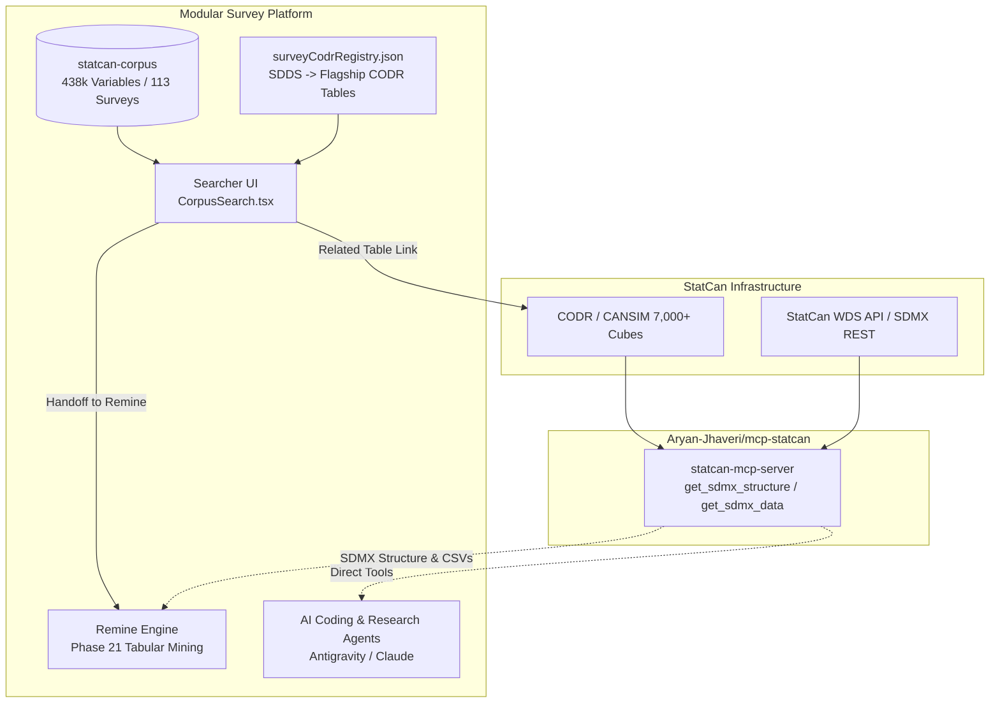

# Integration Plan: Connecting StatCan CODR Data Cubes & `mcp-statcan` to Modular Survey Tools

*Date: 2026-10-04*  
*Target Modules: Searcher (`@mobilesurvey/metadata-registry`, `platform/hub`), Remine (`@mobilesurvey/remine`), and Agent Workflows.*

---

## 1. Executive Summary & Core Principle

Statistics Canada operates across two distinct data layers:
1. **Microdata (Surveys & Questionnaires):** Variables, question stems, interview instructions, response codes, skip patterns, and GSIM derivation DAGs (indexed in our `statcan-corpus` across 438,931 variables).
2. **Macrodata (CODR / CANSIM Data Cubes):** Aggregated multi-dimensional tables, SDMX codelists, coordinates, and time series vectors (served via StatCan WDS and [`mcp-statcan`](https://github.com/Aryan-Jhaveri/mcp-statcan)).

**The Core Principle:**
> Microdata variables and CODR tables do **not** have a clean 1:1 relationship. Attempting to claim a variable maps directly to a table creates false equivalences (due to suppression, recoding, weighting, and multidimensional cross-tabulation).  
> Instead, connections must be anchored at the **Survey Program & SDDS Level (Deterministic)** with **Topic/Semantic Candidate Matching (Transparently Scoped)**, explicitly presented as **"Official Dissemination Tables for this Survey / Topic"**.

---

## 2. Information Architecture & Linkage Taxonomy

We establish a 3-tier linkage hierarchy:

```
┌────────────────────────────────────────────────────────────────────────┐
│ Tier 1: Deterministic Survey/SDDS Anchor (Confidence: 1.0)             │
│ Map Survey Program Acronym / SDDS ID -> Official CODR Table Series    │
│ (e.g. LFS / SDDS 3701 -> 14-10-0287-01, 14-10-0017-01, etc.)           │
└────────────────────────────────────┬───────────────────────────────────┘
                                     │
┌────────────────────────────────────▼───────────────────────────────────┐
│ Tier 2: Subject & Keyword Cluster Matching (Confidence: 0.70 - 0.85)   │
│ Match query / concept domain against StatCan Table Subject Hierarchy   │
│ (e.g. "food insecurity" -> Subject 13-10 / Table 13-10-0834-01)        │
└────────────────────────────────────┬───────────────────────────────────┘
                                     │
┌────────────────────────────────────▼───────────────────────────────────┐
│ Tier 3: SDMX Dimension Member Cross-Reference (Confidence: 0.50 - 0.70)│
│ Variable code labels matching SDMX Dimension codelists via mcp-statcan │
│ (e.g. LFS "Full-time" / "Part-time" -> SDMX Dimension "Type of work")  │
└────────────────────────────────────────────────────────────────────────┘
```

---

## 3. Architecture & Data Flow



---

## 4. Component-by-Component Implementation Plan

### Phase 1: Survey-to-CODR Knowledge Registry (`surveyCodrRegistry.json`)
* **Location:** `platform/hub/src/data/surveyCodrTables.json` and `@mobilesurvey/metadata-registry`
* **Data Structure:**
  ```json
  {
    "LFS": {
      "sdds": "3701",
      "programTitle": "Labour Force Survey",
      "primarySubject": "Labour",
      "tables": [
        {
          "pid": "1410028701",
          "dGuid": "14-10-0287-01",
          "title": "Labour force characteristics by industry, monthly, unadjusted for seasonality",
          "releaseFrequency": "Monthly",
          "keywords": ["employment", "unemployment", "industry", "hours"]
        },
        {
          "pid": "1410001701",
          "dGuid": "14-10-0017-01",
          "title": "Labour force characteristics by sex and detailed age group",
          "releaseFrequency": "Monthly",
          "keywords": ["age", "sex", "youth", "participation rate"]
        }
      ]
    },
    "CCHS": {
      "sdds": "3226",
      "programTitle": "Canadian Community Health Survey",
      "primarySubject": "Health",
      "tables": [
        {
          "pid": "1310083401",
          "dGuid": "13-10-0834-01",
          "title": "Household food security by living arrangement and main source of income",
          "releaseFrequency": "Annual",
          "keywords": ["food security", "income", "household"]
        }
      ]
    }
  }
  ```
* **Harvesting Pipeline:** A lightweight deterministic script in `tools/metadata/statcan-corpus/src/codr/seedCodrTables.ts` that cross-references StatCan's open survey-to-cube index.

---

### Phase 2: Searcher UI Integration (`CorpusSearch.tsx`)

#### A. Survey Program Context Header / Filter Bar
When a user filters by a survey (e.g. `Labour Force Survey (LFS)`), Searcher displays an informative banner:
* **"Official Dissemination Tables"** badge with a count of major published CODR cubes.
* Clicking opens a drawer showing the flagship tables, their update frequency, and direct links to StatCan's viewer (`https://www150.statcan.gc.ca/t1/tbl1/en/tv.action?pid=...`).

#### B. Search Result Hit Cards (`CorpusHit`)
On individual variable cards:
* Add a subtle disclosure block:
  ```
  📊 Related Dissemination Tables (Survey: Labour Force Survey)
  • Table 14-10-0287-01: Labour force characteristics by industry
  • Table 14-10-0072-01: Job permanency by industry and occupation
  [View on StatCan ↗]  [Explore in Remine ↗]
  ```
* **Truth-in-Metadata Notice:**  
  *"Note: StatCan publishes aggregated indicator cubes at the survey program level. Estimates in published tables may recode, weight, or aggregate this specific microdata variable."*

#### C. Data Cart Handoff (`useDataCart`)
* Allow users to save both microdata variables and their associated CODR table product IDs into their Data Cart export (`ddi-cart.json`), giving downstream researchers both questionnaire variables and published benchmark tables.

---

### Phase 3: Bridge to Phase 21 (Remine: Tabular Mining Engine)

`mcp-statcan` becomes the core ingestion adapter for **Remine** (`@mobilesurvey/remine`):
1. **Dimension Discovery:** Remine calls `get_sdmx_structure` (or local WDS equivalent) to retrieve dimension codelists (`Type of work`, `Geography`, `Age group`).
2. **Slice Extraction:** Calls `get_sdmx_data` to download tidy CSV slices directly without context window starvation.
3. **Automated Analysis:** Remine runs its deterministic probe library (gaps, trajectories, rank reversals) on the downloaded CODR slice and formats findings back into the Hub Analyzer.

---

### Phase 4: Agent & MCP Workflow Enablement

Enable seamless pairing between the user/agent and official StatCan data:
1. **Configuring `mcp-statcan` in Antigravity / Claude Code:**
   * Hosted Render connection: `https://mcp-statcan.onrender.com/mcp`
   * Local connection via `uvx statcan-mcp-server --transport http`
2. **Agent Skills / Slash Commands:**
   * When asked to build a questionnaire or test a concept in `@mobilesurvey/designer`, the agent can inspect existing CODR table structures to mirror official Statistics Canada standard categories (e.g., standard educational attainment, NAICS industry groupings).

---

## 5. Phased Delivery Roadmap

| Milestone | Deliverables | Dependencies |
|---|---|---|
| **M1: Survey CODR Registry** | Extract & curate flagship CODR tables for top 25 StatCan survey programs (`surveyCodrTables.json`). | `surveyImdbLinks.json` |
| **M2: Searcher UI Integration** | Add "Related Dissemination Tables" section to Survey header and Hit Cards with clear attribution wording. | M1 |
| **M3: MCP Agent Connection** | Document and configure `mcp-statcan` for local agent testing and dimension inspection. | `mcp-statcan` |
| **M4: Remine Ingest Adapter** | Connect `mcp-statcan` SDMX structure and data download to `@mobilesurvey/remine` probe library. | M1, Phase 21 |
