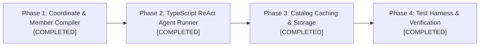

# StatCan Assistant: Implementation Roadmap

Engineering milestones and implementation status for `@mobilesurvey/statcan-assistant`.

---

## Progress Overview

---

## Phase 1: Coordinate & Member Resolution & Gate 0 (Status: ✅ Completed)
* **Coordinate & Wildcard Resolution**:
  * Implemented multi-coordinate requests in `src/engine/statcan-wds.ts`.
  * Supports fetching multiple series across dimension coordinate slices in a single WDS call.
* **Fuzzy Member Matching**:
  * Implemented diacritic-insensitive, stemmed token matching in `src/engine/fuzzy-matcher.ts`.
  * Automatically maps queries like "Ontario" and "Unemployment rate" to exact StatCan dimension positions and member IDs.
* **Gate 0: Code Bouncer**:
  * Implemented `src/engine/fact-binder.ts: gateZeroFilter()`.
  * Automatically nullifies suppressed points (`symbol: 'F'` or `'x'`) to prevent misleading chart spikes.
  * Surfaces high-variability warnings (`symbol: 'E'`, CV 25%–35%).
  * Multiplies and humanizes scalar factors (e.g. Code `3` = Thousands, Code `6` = Millions).

## Phase 2: Autonomous TypeScript ReAct Agent Runner (Status: ✅ Completed)
* **Agent State Machine & Tool Dispatch**:
  * Implemented `src/agent/agent-runner.ts: StatCanAgentRunner`.
  * Supports OpenRouter / OpenAI-compatible streaming endpoints with deterministic offline fallback.
  * Emits streaming `AgentEvent` objects (`tool_call` start, duration in ms, preview).
* **Context Reuse**:
  * Supports follow-up chart changes (e.g. "change to bar chart", "sort descending") reusing in-memory rows without re-fetching from WDS.
* **Zero-Numeral Contract Enforcement**:
  * Implemented Remine's AST/regex bare numeral scanner (`checkBareNumerals`) and template token binder (`bindFactTokens`).
  * Forbids freehand LLM numerical hallucinations; binds narrative text to verified WDS fact tokens.

## Phase 3: Table Catalogue Caching (Status: ✅ Completed)
* **Local Catalogue Storage**:
  * Implemented browser `localStorage` caching for `getAllCubesListLite` (~7,000 tables, ~2.5MB), eliminating cold-start search latency.
* **Metadata Memoization**:
  * In-memory cache for `getCubeMetadata` so repeat inquiries about the same table resolve instantly.

## Phase 4: Production Hardening, Testing & Verification (Status: ✅ Completed)
* **Vitest Test Suite**:
  * `tests/fact-binder.test.ts`: 6 tests verifying Gate 0 suppression, scale factor mapping, bare numeral rejection, and token binding.
  * `tests/fuzzy-matcher.test.ts`: 3 tests verifying diacritic stripping, similarity scoring, and coordinate compilation.
  * `tests/chart-spec.test.ts`: 3 tests verifying declarative Vega-Lite generation for line, bar, and scatter plots.
  * **All 12 unit tests passing**.
* **Vite Production Build**:
  * Verified production build: `npx vite build` (61ms, zero errors).
* **Academic Provenance Card**:
  * Renders canonical StatCan table link (`PID`), exact coordinate string, Vector Series IDs, frequency, seasonal adjustment status, and ISO 8601 extraction timestamp.
